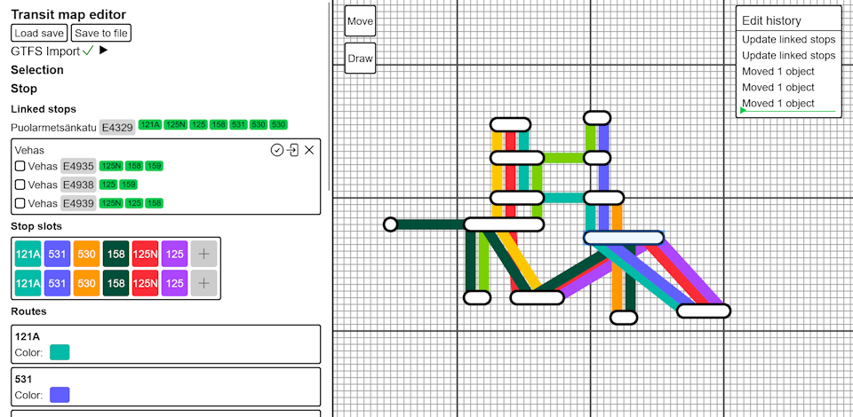

# Transit map editor
A transit map editor that uses GTFS data to guide the map making. Runs completely locally in the browser. The project is not completeand is in alpha.

## Current features
- GTFS importing (url and file upload)
    - The GTFS is parsed and processed, then pushed into a sqlite DB running in OPFS (origin private file system), which allows the caching of large datasets
    - Stop searching
- Basic editor
    - SVG-based for easier saving
    - Object selection and moving
    - Two modes: Draw and move
    - Stop editing and linking
    - Undoing/redoing system
- File saving and loading (WIP)

## Repo structure

### /src
#### /src/db
- Drizzle schema and db init
#### /src/shapes
- Selectable map shapes
- All extend SelectableShape
#### /src/ui
- Scripts that interface with UI
### /src/util
- General utility scripts, for example: GTFS processing, grid, save system, undo system

## Usage

1. Open the site (localhost or [tme.hekinav.dev](https://tme.hekinav.dev/))
2. Import GTFS feed (CPU-intensive, large feeds take a long time and/or may use more memory than permitted by the browser which results in a site crash)
- Example gtfs feeds (feels free to use any other feed, almost all GTFS spec features (excl. frequencies.txt) are supported): 
  - [HSL](https://infopalvelut.storage.hsldev.com/gtfs/hsl.zip) (recommended)
  - [All of Finland](https://mobility.mobility-database.fintraffic.fi/static/finland_gtfs.zip) ⚠️ Extremely large feed
  - [All of Finland as separate feeds](https://api.digitransit.fi/routing-data/v3/finland/) (Requires [free api key](https://digitransit.fi/en/developers/api-registration/))
3. Link your first stop to a real one on the map by selecting the stop and searching in the search box
4. Start using the **Adjacent Stops** menu to add new stops

## Running locally (vite)

1. Start dev server: `npm run dev`
2. Compile production build: `npm run build`
2. Preview production build: `npm run preview`
2. Deploy to Cloudflare Workers: `npm run preview`

## Why did I make this?
I simply wanted to try to make a tool to help me make and validate transit maps with GTFS data